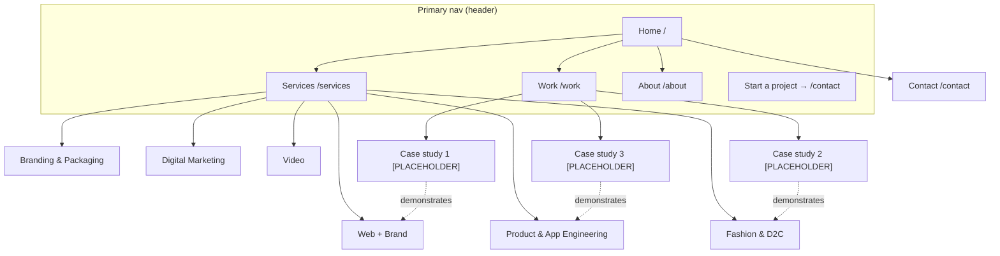

# 01 — Site Architecture — aditeraction.com

> Produced with the **site-architecture** skill (v1.1.0). Planning only — no app code created or modified.
> Source context: `.agents/brand-context.md`, `.agents/brand-identity.md`, `.agents/brand-guidelines.md` + task brief.

## Discovery inputs (as supplied — not invented)

| Field | Value |
|-------|-------|
| Business | Aditeraction — design-and-engineering studio, founder-led (founder: Aditya) |
| What it does | Takes founders from idea to launched brand, site and app |
| Site type | **Small business / Agency-consultancy hybrid** (service studio) — maps to agency template |
| State | **New site** (rebuild of aditeraction.com). No legacy URLs to preserve/redirect were supplied → see §8 |
| Primary audiences | Founders & small teams, India + international **equal weight**, any sector |
| Top 3 site goals | 1) Qualified inbound leads (India + intl) · 2) Credibility via shipped work · 3) Organic + AI-answer discovery |
| Stack | TanStack Start (SSR) + React 19 + TS + Tailwind v4 + Bun on Cloudflare Workers |
| Hero | WebGL particle animation, lazy-loaded over a static SVG fallback; **all copy is real SSR text** (fully crawlable) |

Depth target: **2 levels** (small-business/agency pattern). Everything important is reachable within **2 clicks** of Home — well inside the 3-click rule.

---

## 1. Page hierarchy (ASCII tree)

```
Home (/)
├── Services (/services)                              ← hub
│   ├── Web + Brand (/services/web-and-brand)
│   ├── Product & App Engineering (/services/product-app-engineering)
│   ├── Fashion & D2C (/services/fashion-d2c)
│   ├── Branding & Packaging (/services/branding-packaging)
│   ├── Digital Marketing (/services/digital-marketing)
│   └── Video (/services/video)
├── Work (/work)                                      ← portfolio hub
│   ├── [PLACEHOLDER case study 1] (/work/[project-slug-1])
│   ├── [PLACEHOLDER case study 2] (/work/[project-slug-2])
│   └── [PLACEHOLDER case study 3] (/work/[project-slug-3])
├── About (/about)
└── Contact (/contact)
```

**Notes**
- "Premium design for founders" is **positioning, not a page** — it lives in Home + Services hub copy, not as a URL. (Per brief.)
- Case-study slugs are placeholders until real projects are confirmed (see §8 and the hard rule on invented facts).
- All service-page copy and case-study copy are SSR text; the WebGL hero is decorative and must never hold indexable copy.

---

## 2. Visual sitemap (Mermaid)



---

## 3. Final URL list (slugs)

Trailing-slash policy: **no trailing slash**, all lowercase, hyphens only. Enforce one canonical form (301 any variant).

| # | Page | URL | Parent |
|---|------|-----|--------|
| 1 | Home | `/` | — |
| 2 | Services (hub) | `/services` | `/` |
| 3 | Web + Brand | `/services/web-and-brand` | `/services` |
| 4 | Product & App Engineering | `/services/product-app-engineering` | `/services` |
| 5 | Fashion & D2C | `/services/fashion-d2c` | `/services` |
| 6 | Branding & Packaging | `/services/branding-packaging` | `/services` |
| 7 | Digital Marketing | `/services/digital-marketing` | `/services` |
| 8 | Video | `/services/video` | `/services` |
| 9 | Work (hub) | `/work` | `/` |
| 10 | Case study (template) | `/work/[project-slug]` | `/work` |
| 11 | About | `/about` | `/` |
| 12 | Contact | `/contact` | `/` |

Slug rationale: each service slug carries its core search term while staying short. `/services/web-and-brand` is kept brand-accurate (it is deliberately *not* split into `/web-design` + `/branding` because the offer is sold as one combined service). `/work` chosen over `/case-studies` for a shorter, cleaner portfolio URL; the longer phrase is targeted in copy/H1 instead.

---

## 4. Primary navigation (header)

4 nav items + 1 CTA (within the 4–7 rule). Logo left → Home.

| Order | Item | Target | Behaviour |
|-------|------|--------|-----------|
| Logo | Aditeraction mark | `/` | Links home |
| 1 | Services | `/services` | Dropdown: the 6 service pages (single column, 6 items — no sub-levels) |
| 2 | Work | `/work` | Direct link |
| 3 | About | `/about` | Direct link |
| 4 | Contact | `/contact` | Direct link |
| CTA | **Start a project** | `/contact` | Rightmost, Vermilion solid button (one accent per view) |

- Services dropdown lists all 6 services so every spoke is reachable in **1 click** from any page.
- Mobile: same items in a drawer; Services expands inline to the 6 services.

---

## 5. Footer navigation

Four columns + brand block. (Legal column flagged — see §8.)

| Column | Links |
|--------|-------|
| **Services** | Web + Brand · Product & App Engineering · Fashion & D2C · Branding & Packaging · Digital Marketing · Video |
| **Studio** | Work · About · Contact |
| **Connect** | Email `info@aditeraction.com` · WhatsApp `[PLACEHOLDER — +91 75640 78141 from brand guidelines, confirm public use]` · LinkedIn `[PLACEHOLDER URL]` · Instagram `[PLACEHOLDER URL]` |
| **Legal** *(flagged, see §8)* | Privacy · Terms |

Brand block: logo + tagline **"Idea to launched."** on its own line; descriptor **"Brand, site, app. One roof."** on a separate line (never the same visual line — per brand rule). Vermilion full-stop on the tagline where colour renders.

---

## 6. Breadcrumb trail per page type

Breadcrumbs mirror the URL path exactly. Every segment is a link except the current (last) page. Home is always the root segment. (No breadcrumb rendered on Home itself.)

| Page type | Breadcrumb trail |
|-----------|------------------|
| Home | *(none — root)* |
| Services hub | `Home > Services` |
| Service page | `Home > Services > {Service name}` |
| Work hub | `Home > Work` |
| Case study | `Home > Work > {Case study title}` |
| About | `Home > About` |
| Contact | `Home > Contact` |

Examples:
- `/services/web-and-brand` → `Home > Services > Web + Brand`
- `/work/[project-slug-1]` → `Home > Work > [PLACEHOLDER project title]`

Implementation note: emit `BreadcrumbList` JSON-LD on every page except Home (schema spec lives in `02-seo-plan.md §5`). Render breadcrumbs as real SSR links below the header, above content.

---

## 7. Internal-linking map

### 7.1 Rules applied
- **No orphans**: every page has ≥1 inbound internal link (nav + footer guarantee this for all 12 pages).
- **Descriptive anchors**: e.g. "our web + brand service", never "click here".
- **Breadcrumbs = free internal links** on all non-home pages.
- **Important pages get the most inbound links**: Home, `/services`, and `/services/web-and-brand` (flagship) are linked most often.

### 7.2 Link graph (who links to whom)

| From ↓ | Links to |
|--------|----------|
| **Home** | All 6 service pages (service cards) · `/services` (hub) · `/work` + 2–3 featured case studies · `/about` · `/contact` (hero + nav CTA) |
| **Services hub `/services`** | All 6 service pages (hub → spoke) · `/work` ("see it shipped") · `/contact` |
| **Service page** (each) | `/services` (breadcrumb up) · **2–3 related service pages** (spoke ↔ spoke, see §7.3) · relevant case study/studies ("Related work") · `/contact` (CTA) |
| **Work hub `/work`** | All case studies · `/services` ("the services behind this work") |
| **Case study** | **The service page(s) it demonstrates** (case study → service, primary contextual link) · `/work` (breadcrumb up) · 1–2 related case studies · `/contact` |
| **About** | `/services` · `/work` · `/contact` · founder entity links `[PLACEHOLDER LinkedIn]` |
| **Contact** | `/services` · `/work` (keep lightweight; conversion page) |

### 7.3 Spoke ↔ spoke related-service map (2–3 each, bidirectional where natural)

| Service | Related services it links to |
|---------|------------------------------|
| Web + Brand | Product & App Engineering · Branding & Packaging · Digital Marketing |
| Product & App Engineering | Web + Brand · Digital Marketing |
| Fashion & D2C | Branding & Packaging · Web + Brand · Video |
| Branding & Packaging | Web + Brand · Fashion & D2C · Video |
| Digital Marketing | Web + Brand · Video · Fashion & D2C |
| Video | Branding & Packaging · Digital Marketing · Fashion & D2C |

### 7.4 Hub-and-spoke summary (feeds `03-topic-clusters.md`)
- **Hub** = `/services`. **Spokes** = 6 service pages + case studies.
- Every spoke links up to the hub with a keyword-rich anchor; the hub links down to every spoke; case studies link into the service(s) they prove.

### 7.5 Link-audit checklist (target state for build)
- [ ] Every one of the 12 pages has ≥1 inbound internal link (nav/footer guarantee)
- [ ] No broken internal links (404s) — verify on build
- [ ] Anchor text descriptive, not "click here/read more"
- [ ] Home, `/services`, `/services/web-and-brand` carry the most inbound links
- [ ] `BreadcrumbList` implemented on all non-home pages
- [ ] Each case study contextually links to the service(s) it demonstrates
- [ ] Each service page links to ≥1 case study (or a "work coming soon" state until case studies exist — see §8)

---

## 8. Flags, open decisions & recommendations (not decided here)

1. **Legacy URLs / redirects** — none were supplied. If the current aditeraction.com has live indexed URLs, a 301 redirect map is required before launch to preserve link equity. **Action needed from owner:** export existing URL list. → `[PLACEHOLDER: legacy URL inventory]`
2. **Case studies depend on real data** — all `/work/*` pages are placeholders. Per the hard rule, no client names, metrics or testimonials are invented. Until ≥1 real case study exists, service pages should link to a "Selected work" / "Work coming soon" state rather than a fabricated study.
3. **Legal pages (`/privacy`, `/terms`)** — outside the stated in-scope list but **standard and recommended** for a real launch (and for trust/E-E-A-T). Added to footer as flagged utility links; confirm before build.
4. **Blog / Insights** — intentionally **excluded** from current scope (cluster uses service pages + case studies as spokes, per brief). Flagged as the highest-value **future** expansion for topical authority and AEO/GEO citation surface. Revisit post-launch.
5. **hreflang** — No regional versions are planned and the audience is served by a single global English site. **Recommendation: do NOT implement hreflang now** — with one language/one URL set it adds complexity for no benefit. Reconsider only if India-specific or other-locale URLs are later introduced. (Flagged, not decided — owner to confirm.)
6. **Contact method** — WhatsApp/phone from brand guidelines reproduced as `[PLACEHOLDER]` pending confirmation they are intended for public web display.

---

## Deliverable status (site-architecture skill output)

| Required deliverable | Status |
|----------------------|--------|
| Page hierarchy (ASCII tree) | ✅ §1 |
| Visual sitemap (Mermaid) | ✅ §2 |
| URL map table | ✅ §3 |
| Navigation spec (header/footer/breadcrumbs) | ✅ §4–§6 |
| Internal-linking plan | ✅ §7 |

The site-architecture skill produces **no numeric score** — its result is the five deliverables above plus the §7.5 link-audit checklist (all items specified as target state for build).
