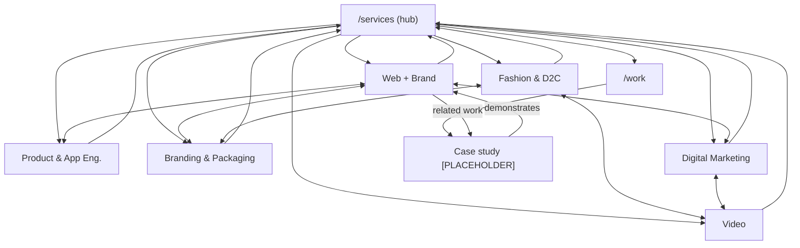

# 03 — Topic Cluster Plan — aditeraction.com

> Produced with the **topic-cluster-planning** skill. Planning only.
> Hub = `/services`. Spokes = the 6 service pages + case studies (per brief). Builds on `01` and `02`.

A note on method: this skill is written for *content/blog* clusters (pillar guide + articles). Here the brief fixes the cluster to the **commercial service architecture** — the hub is the Services page and the spokes are service pages and case studies, not blog posts. The skill's hub-and-spoke linking logic, publishing-order discipline, and link-weight rules are applied to that service structure. SERP research in Steps 1–3 was **not run live** (no browsing performed in this planning pass); difficulty is reasoned from the competitive archetypes in `brand-context.md` and flagged accordingly.

---

## Cluster overview

| | |
|---|---|
| **Seed topic** | "design and engineering studio" (brand, website & app under one roof) |
| **Hub** | `/services` |
| **Spokes** | 6 service pages + N case studies |
| **Estimated difficulty** | **Moderate** — reasoned, `[PLACEHOLDER: confirm with SERP/keyword tool]`. "Design and engineering studio" as a combined entity is lightly contested; the component terms ("web design studio", "branding agency India", "D2C branding") are **Hard** and dominated by established agencies + marketplaces. The combined "one roof / idea to launched" angle is the differentiated, winnable wedge. |
| **Realistic build-out** | 6 service spokes over ~Weeks 1–12; case-study spokes continuously as real projects ship (gated on data). Topical-authority signal matures ~6–9 months. |

---

## The Hub — `/services`

- **Recommended format:** **Category page with curated featured content** (not an "ultimate guide"). This is a service studio, so the hub is a commercial category page that frames the "one roof" offer and routes to each service — *not* a long informational pillar. (Per skill: category hub is correct for product/service topics.)
- **Target keyword (broad seed):** `design and engineering studio` / `branding, web & product services` (+ India variants, equal weight — see `02 §2`).
- **Main H2 sections (breadth, not depth):**
  1. One roof: brand, site, app, marketing, video (the thesis)
  2. Web + Brand → links to spoke
  3. Product & App Engineering → links to spoke
  4. Fashion & D2C → links to spoke
  5. Branding & Packaging → links to spoke
  6. Digital Marketing → links to spoke
  7. Video → links to spoke
  8. How we work (founder-led, idea→launched) — brief
  9. Selected work → `/work` + 2–3 featured case studies
  10. Start a project → `/contact`
- **Approx length:** ~700–900 words (routing + framing; breadth only).
- **What the hub must NOT do in depth:** pricing specifics, full methodology, deliverables lists, or tech detail for any single service — those belong on the spoke. The hub summarises; the spoke answers.

---

## Spoke list

Service spokes are fixed by the brief (all 6 required). Sorted by priority (mirrors `02 §4`). "Hub anchor text" = the descriptive anchor the hub uses to link down, and the keyword-rich anchor the spoke uses to link **up** to the hub.

| # | Spoke | URL | Target keyword (intl + India) | Content type | Words | Hub ↔ spoke anchor |
|---|-------|-----|-------------------------------|--------------|-------|--------------------|
| 1 | Web + Brand | `/services/web-and-brand` | `web design and branding studio` / `website design and branding company India` | Service | ~900 | "web design & branding" |
| 2 | Product & App Engineering | `/services/product-app-engineering` | `custom app development studio` / `product engineering studio India` | Service | ~900 | "product & app engineering" |
| 3 | Branding & Packaging | `/services/branding-packaging` | `branding and packaging design studio` / `logo & packaging design India` | Service | ~800 | "branding & packaging" |
| 4 | Digital Marketing | `/services/digital-marketing` | `digital marketing for startups` / `digital marketing agency for startups India` | Service | ~800 | "digital marketing" |
| 5 | Fashion & D2C | `/services/fashion-d2c` | `D2C branding studio` / `D2C branding agency India` | Service | ~850 | "fashion & D2C" |
| 6 | Video | `/services/video` | `brand video production studio` / `brand video production India` | Service | ~800 | "brand & product video" |
| 7+ | Case study (per project) | `/work/[project-slug]` | `[PLACEHOLDER sector] + [service] case study` | Case study (`Article`) | ~1,000+ | up to `/work` + into the service(s) it proves |

Case-study spokes are the **highest-value** rows for E-E-A-T and GEO citation but cannot be written until real project data exists (hard rule — no invented facts). Each one owns a long-tail its service page only summarises.

---

## Internal link map

### Directional rules (per brief + skill)
- **Hub → spoke:** `/services` links to **all 6** service pages (in the H2 sections) and to `/work` + featured case studies.
- **Spoke → hub:** every service page links **up** to `/services` with a keyword-rich anchor — placed as the **first contextual in-body link** (Google weights the first body link to the hub most heavily; keep it contextual, not just the breadcrumb).
- **Spoke ↔ spoke:** each service links to **2–3 related services** only where natural (map below) — not all-to-all.
- **Case study → service:** every case study links **into the service page(s) it demonstrates** (primary contextual link), plus up to `/work` (breadcrumb) and 1–2 related case studies.
- **Service → case study:** each service page links **down** to ≥1 relevant case study ("Related work"), or a "work coming soon" state until data exists.
- Breadcrumbs (`01 §6`) provide the structural up-links in addition to the contextual ones.

### Spoke ↔ spoke adjacency (from `01 §7.3`)
```
Web + Brand        → Product & App Engineering · Branding & Packaging · Digital Marketing
Product & App Eng. → Web + Brand · Digital Marketing
Fashion & D2C      → Branding & Packaging · Web + Brand · Video
Branding & Pkg.    → Web + Brand · Fashion & D2C · Video
Digital Marketing  → Web + Brand · Video · Fashion & D2C
Video              → Branding & Packaging · Digital Marketing · Fashion & D2C
```

### Case-study → service mapping (template — fill per real project)
| Case study | Demonstrates (links into) |
|------------|---------------------------|
| `/work/[project-slug-1]` `[PLACEHOLDER]` | e.g. Web + Brand (+ Branding & Packaging) |
| `/work/[project-slug-2]` `[PLACEHOLDER]` | e.g. Fashion & D2C (+ Branding & Packaging) |
| `/work/[project-slug-3]` `[PLACEHOLDER]` | e.g. Product & App Engineering (+ Web + Brand) |

### Link graph (Mermaid)


---

## Publishing sequence (adapted)

The skill's rule — *don't launch the hub as a link-less orphan* — is adapted for a site that ships as one release:

1. **Weeks 1–4 (Foundation):** publish **3–4 flagship spokes first** — Web + Brand, Product & App Engineering, Branding & Packaging (+ Home). These exist before the hub has anything to point to.
2. **Weeks 3–4:** publish the **hub `/services`**, now linking down to the live spokes.
3. **Weeks 5–12 (Expansion):** publish the remaining spokes — Digital Marketing, Fashion & D2C, Video — each linking up to the now-established hub.
4. **Continuous:** publish **case-study spokes** as each real project completes; each links into its service page and up to `/work`. (Gated on real data — `[PLACEHOLDER]`.)

If the site must go live all-at-once, preserve the *linking* discipline even when pages ship together: ensure the hub links only to live spokes and every spoke's first in-body link targets the hub.

---

## External linking strategy (hub)

The hub (and relevant spokes) should cite **3–5 authoritative, non-competitor** sources to support claims and aid GEO trust — e.g.:
- Web standards / performance: web.dev (Core Web Vitals), W3C.
- Platform primary sources where cited (e.g. Shopify docs for D2C, React/TanStack docs for engineering).
- Recognised design-system or accessibility references (WCAG).
`[PLACEHOLDER: finalise exact URLs]`. Do **not** link to competing studios/agencies. Keep external links sparing and genuinely authoritative.

---

## Success metrics (cluster)

| Checkpoint | Target |
|-----------|--------|
| Month 3 | Hub `/services` indexed and ranking top-50 for the seed term; ≥3 spokes indexed |
| Month 6 | ≥2–3 spokes ranking top-20 for their long-tail (esp. flagship Web + Brand); ≥1 real case study live |
| Month 9 | Hub trending toward top-20; cluster driving consistent qualified organic (India + intl) |
| Month 12 | Cluster reads as a topical-authority signal for the domain; AI engines cite the studio for "idea to launched / one roof" queries |

All numeric baselines/targets to be set from live GSC data — not fabricated.

---

## Next step (per skill)

For each spoke, run **content-brief** with the spoke's target keyword to produce a writer-ready brief, then **write-content** — applying `brand-guidelines.md` voice (straight, sharp, specific; no "synergy/world-class/revolutionary"; "Aditeraction" one word) and the hard rule: **no invented stats, clients or testimonials** — `[PLACEHOLDER]` until real data is supplied.

---

## Deliverable status (topic-cluster-planning skill output)

| Skill section | Where |
|---------------|-------|
| Cluster overview (+ **difficulty: Moderate**) | top |
| Hub (format + keyword + H2s + exclusions) | Hub section |
| Spoke list (table) | Spoke list |
| Internal link map (directions) | Internal link map |
| Publishing sequence | Publishing sequence |
| External linking | External linking |
| Success metrics | Success metrics |

The topic-cluster-planning skill's nearest thing to a "score" is the **difficulty rating = Moderate** (flagged for SERP-tool confirmation).
